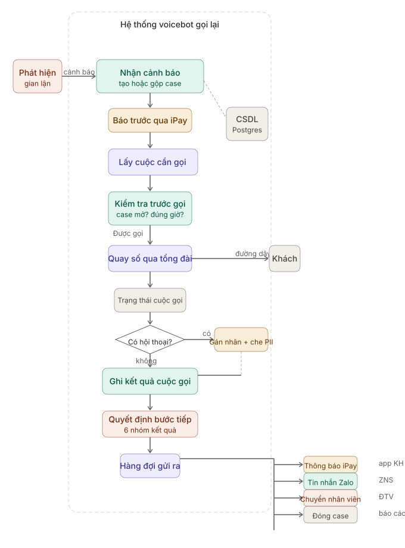

# voicebot_callback

Bộ campaign rules + DB + LLM labeler + scheduler cho voicebot xác thực giao dịch thẻ nghi gian lận

## Luồng xử lý



## Cấu trúc

```
voicebot_callback/
├── campaign_rules.yaml       # Mọi con số: P1/P2/P3, khoảng chờ, khung giờ, ZNS
├── callback/                 # Rule engine (hàm thuần)
│   ├── models.py             # Enum + dataclass
│   ├── config.py             # Đọc & kiểm tra YAML
│   ├── urgency.py            # Tính P1/P2/P3 từ dữ liệu cảnh báo
│   ├── pbx.py                # Map call_status/SIP -> Outcome
│   └── rules.py              # decide / pre_dial_check / merge_alert
├── db/                       # Lưu trữ + luồng xử lý (Postgres)
│   ├── schema_postgres.sql   # 7 bảng
│   ├── driver.py             # Wrapper psycopg: placeholder, RETURNING, retry
│   ├── repo.py               # SQL thuần
│   └── service.py            # CallbackService ghép rule engine + DB
├── llm/                      # Gán nhãn transcript
│   ├── pii.py                # Che số thẻ / ĐT / CCCD / OTP / số tiền
│   └── labeler.py            # Prompt + validate + fallback UNCLEAR
├── scheduler.py              # Worker: nhận lịch -> gọi -> ghi kết quả -> đẩy outbox
├── tests/                    # 102 unit test (unittest, không cần pytest)
├── demo_rules.py             # Mô phỏng rule engine
└── demo_db.py                # Mô phỏng cả luồng lưu DB
```

## Chạy

Cần Python 3.10+ và một Postgres chạy sẵn (dễ nhất là qua `docker compose`, xem dưới).

```bash
pip install -r requirements.txt
export CALLBACK_DB_URL=postgresql://postgres:cb@localhost:5432/callback
python -m unittest discover -s tests -t . -v   # ~102 test
python demo_rules.py                             # mô phỏng text, không cần DB
python seed_demo.py && python app.py             # nạp data + mở dashboard
```

Test `test_rules.py` và `test_llm.py` không cần DB, chạy luôn.
Test `test_db.py` và `test_scheduler.py` tự skip nếu không có `CALLBACK_DB_URL`.

## Docker Compose

```bash
docker compose up       
# mở http://localhost:5000
docker compose down      # tắt
docker compose down -v   # tắt + xóa dữ liệu PG
```

Trên Codespaces, port 5000 sẽ tự được chuyển ra ngoài - click vào tab PORTS,
copy URL public cho mentor. Mỗi case có timeline các quyết định của rule engine
(mỗi bước có badge nhóm, lý do, lịch gọi tiếp, ZNS, nhãn LLM) và danh sách cuộc
gọi + outbox + ZNS.

### Dialer tích hợp Freeswitch/Asterisk

Dialer là callable `(ScheduledCall, Decision) -> DialResult`. Trong `DialResult` điền `pbx_status`, `sip_code`, `answered_seconds`, `machine_detected`, `verified` (bot đã xác thực thành công trước khi rớt chưa), và `llm` (nếu đã chạy LLM labeler ngay sau cuộc gọi).

## Luật nghiệp vụ

Mọi con số nằm ở [campaign_rules.yaml](campaign_rules.yaml). Nguồn: `YEU_CAU_BAI_TOAN_VOICEBOT` mục 4 (Redial Policy). Các chỗ docs không nói mà mình tự chốt đều có chú thích `GIẢ ĐỊNH` trong YAML.

Các điểm chính:

- 6 nhóm kết quả cuộc gọi (XONG / DỪNG BOT / NGƯỜI THẬT / RETRY-KH / RETRY-HỆ THỐNG / HẸN).
- P1/P2/P3 tự tính từ trạng thái thẻ, cấp phép, số tiền, số cảnh báo.
- Đếm số cuộc theo cửa sổ 24h trượt, không theo ngày lịch.
- Giới hạn trên mỗi số điện thoại (nhiều case cùng số).
- Lỗi hệ thống không tính lượt; quá 3 lần liên tiếp -> P1 chuyển ĐTV, P2/P3 backoff + báo động vận hành.
- Nhầm số / xác thực sai nhiều lần -> chặn số, không ZNS.
- ZNS KHÔNG được chứa chi tiết giao dịch; config bắt lỗi `{...}` trong mẫu.
- Cảnh báo trùng gộp vào case đang mở, giữ nguyên số lượt đã gọi, nâng mức khẩn nếu cần.
- Mỗi `call_id` chỉ ghi 1 lần (idempotent); mỗi case tối đa 1 lịch sống (unique index).
# Bảng từ ngữ

| Danh mục | Giá trị | Ý nghĩa |
|---|---|---|
| **Mức khẩn** | `P1` | Thẻ còn mở + GD đã cấp phép / ≥50tr / ≥2 cảnh báo. Tối đa 3 cuộc/24h, 24/7, hạn 1 ngày |
| | `P2` | Thẻ đã bị khóa tự động. Tối đa 3 cuộc/24h, 7h–22h, hạn 2 ngày |
| | `P3` | GD đã bị từ chối, thẻ chưa khóa. Tối đa 3 cuộc/24h, 8h–21h, hạn 1 ngày |
| **Trạng thái case** | `OPEN` | Bot đang xử lý |
| | `DONE` | KH đã xác nhận xong |
| | `HUMAN` | Đã chuyển ĐTV, bot không đụng nữa |
| | `STOPPED` | Bot dừng (nhầm số, SIM swap, KH không cho gọi) |
| | `EXHAUSTED` | Hết lượt, không liên hệ được |
| | `CLOSED` | Đóng từ bên ngoài (ĐTV xử lý xong hoặc TWO đóng cảnh báo) |
| **Hành động rule engine** | `DIAL_NOW` | Case còn mở, đủ điều kiện → agent quay số ngay |
| | `SCHEDULE_CALL` | Hẹn giờ gọi lại (ghi vào bảng schedule) |
| | `CLOSE` | KH xác nhận chính chủ → đóng case thành công |
| | `HAND_TO_DTV` | Chuyển ĐTV (nhân viên tổng đài con người) qua hàng đợi |
| | `STOP` | Bot dừng (có thể kèm chặn số) |
| | `EXHAUSTED` | Hết lượt, gửi ZNS cuối, tạo ticket "không liên hệ được" |
| **Nhóm kết quả cuộc gọi** | `XONG` | KH xác nhận chính chủ (tính lượt) |
| | `DỪNG BOT` | Nhầm số, SIM swap, KH từ chối liên hệ |
| | `NGƯỜI THẬT XỬ LÝ` | Phủ nhận GD, bức xúc, ngoài phạm vi bot, không rõ (tính lượt) |
| | `GỌI LẠI - LỖI PHÍA KHÁCH` | Không nghe, bận, tắt máy, người nhà, nghi lừa đảo (tính lượt) |
| | `GỌI LẠI - LỖI PHÍA HỆ THỐNG` | SIP trunk / agent / âm thanh kém (KHÔNG tính lượt) |
| | `KHÁCH HẸN` | KH xin gọi lại giờ cụ thể (KHÔNG tính lượt) |
| **Trạng thái tổng đài** | `Completed` | Cuộc gọi hoàn tất bình thường (KH đã nghe xong) |
| | `No Answer` | Đổ chuông nhưng KH không bắt máy |
| | `Busy` | Máy KH đang bận |
| | `Failed` | Không thiết lập được cuộc gọi (lỗi SIP, số không tồn tại) |
| | `Transferred` | Đã chuyển ĐTV ngay trong cuộc gọi |
| | `Incomplete` | Rớt giữa chừng trước khi hoàn tất |
| **Outcome từ tổng đài** | `no_answer` | Đổ chuông không nghe |
| | `busy` | Máy bận |
| | `rejected` | KH bấm từ chối cuộc gọi |
| | `unreachable` | Tắt máy / ngoài vùng phủ sóng |
| | `invalid_number` | Số không tồn tại |
| | `voicemail` | Vào hộp thư thoại (không để lại lời nhắn) |
| | `short_hangup` | Nhấc máy rồi cúp <5 giây / im lặng |
| | `dropped` | Rớt cuộc gọi trước khi xác thực xong |
| | `transferred` | Đã chuyển ĐTV trong cuộc gọi |
| | `system_error` | Lỗi phía mình: SIP trunk, media adapter, agent |
| | `bad_audio` | Âm thanh kém, bot không nghe được |
| **Outcome do LLM gán** | `verified_confirmed` | KH xác nhận chính chủ thực hiện GD |
| | `verified_denied` | KH phủ nhận GD → nghi gian lận thật |
| | `wrong_number` | Người nghe không phải chủ thẻ |
| | `relative_answered` | Người nhà nghe máy, hứa chuyển máy |
| | `callback_requested` | KH hẹn gọi lại |
| | `verify_failed` | Xác thực danh tính sai nhiều lần → nghi SIM swap |
| | `angry` | KH bức xúc, phàn nàn |
| | `do_not_call` | KH yêu cầu không liên hệ nữa |
| | `other_number_requested` | Người nghe đòi gọi sang số khác |
| | `scam_suspected_hangup` | KH tưởng lừa đảo nên cúp máy |
| | `need_human` | KH đòi gặp người thật / bot không hiểu / ngoài phạm vi |
| | `unclear` | Không xác định được → fallback khi LLM lỗi hoặc confidence thấp |
| **Trạng thái lịch gọi** | `PENDING` | Đang chờ tới giờ gọi |
| | `CLAIMED` | 1 worker đã nhận lịch này, đang chuẩn bị quay số |
| | `DIALING` | Agent đang quay số, chờ kết quả |
| | `DONE` | Đã hoàn tất (có kết quả rồi) |
| | `CANCELLED` | Bị hủy (case đóng, hoặc có cảnh báo mới ghi đè) |
| **Event trong outbox** | `PUSH_IPAY` | Push notification qua iPay app báo trước cuộc gọi |
| | `ZNS` | Có ZNS cần gửi qua Zalo (ZNS gateway đọc) |
| | `DTV_HANDOFF` | Chuyển case cho ĐTV; payload có priority và ticket |
| | `CASE_FINAL` | Case đã kết thúc; dùng đồng bộ với agent của Đạt / báo cáo |
| | `OPS_ALERT` | Có vấn đề cần người check (lỗi hệ thống liên tục...) |
| **Nhân vật & viết tắt** | `ĐTV` | Điện Thoại Viên — nhân viên tổng đài con người |
| | `TWO/TWFA` | Tranzware — hệ thống phát hiện GD thẻ nghi gian lận |
| | `PBX` | Tổng đài nội bộ (Freeswitch/Asterisk) |
| | `SIP trunk` | Đường trung kế SIP nối PBX với telco → KH |
| | `Phone_SMS` | Số KH đã đăng ký nhận tin nhắn, dùng làm số dự phòng |
## Chưa làm

- Nối thật với TWO/TWFA, Freeswitch/Asterisk, agent của Đạt.
- Dashboard theo dõi tình trạng case.
